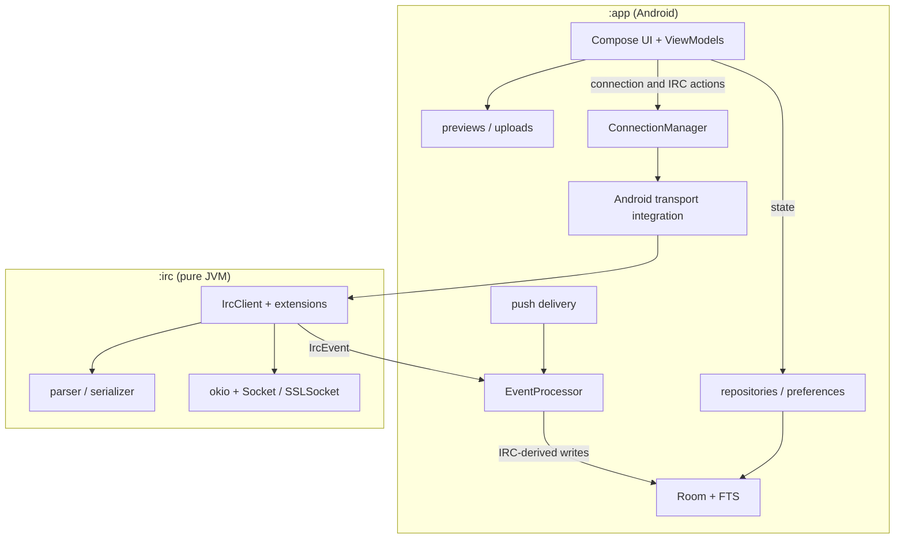

# Architecture

motd has four Gradle modules: `:app` is the Android application, `:irc` is a
pure-JVM IRC engine with no Android dependencies, `:ai-whisper` isolates
the source-built Android voice-transcription runtime, and `:ai-text` contains
the source-built CPU text engine. Native modules have no download API
and do not bundle model weights; the text engine also has a host smoke runner.

## Key invariants

- `EventProcessor` is the only component that writes IRC-derived state to Room.
  Feature-local persistence, such as preferences and upload history, remains
  behind its own repository or preference contract.
- A late IRC `001` after bouncer fallback Ready updates `IrcClient`'s self nick
  before mapping following JOINs. Exact identity changes publish `Registered`
  with current CAP/ISUPPORT snapshots for persistence; the welcome remains `Raw`,
  and late `005` retains the corrected nick.
- UI observes repositories and ViewModel state. Connection and protocol actions
  go through `ConnectionManager` instead of constructing IRC clients in screens.
- Fixed theme contrast normalization is cached on demand per preset and text-color
  mode. `SYSTEM`, `LIGHT`, `DARK`, and `AMOLED` never warm the fixed palette catalog.
- The chat-list Scaffold canvas and chat rows use theme `surface`, matching the top bar's original unscrolled `surface`; its scrolled `surfaceContainerLow` remains unchanged. After the active-scope chip, folder tabs overlay the scrolling chat viewport on an unpainted, transparent strip; the measured tab-and-pinned-mentions header is reserved only for the list's initial position, so rows can scroll beneath it. A separate `surfaceContainerHigh` capsule carries the tabs, and the selected pill uses the stronger `primary`/`onPrimary` colors.
  Selected history-coverage glyphs and advertised-activity dots also use `onPrimary`;
  unselected indicators retain `onSurfaceVariant` and `primary`, respectively.
- Archive pull hints, the revealed folder and the archive-only route share the chat-card
  8dp horizontal/2dp vertical gutters, 16dp shape, 12dp inner inset and density-scaled
  avatar host/vertical padding. `titleMedium` labels may wrap at accessible font scales;
  their shared measured extent, including gutters, drives both pull geometry and list
  translation. The resting fill matches unread chat cards; armed feedback uses `primaryContainer`.
  Pull input reads that measurement live, including before the first recomposition, and keeps
  one release observer/nested-scroll connection across card remeasurement and armed feedback.
  Pulling through 85% of the measured row emits the first haptic and “Keep holding…”;
  1200ms continuously above the 70% disarm boundary reveals the folder while still held,
  with distinct confirmation feedback and an accessibility announcement. Disarm/rearm
  restarts the hold but never repeats the first tick within one gesture. Real pointer-up
  and native cancellation stop the timer synchronously; unfinished pulls settle hidden,
  while a completed reveal survives either. Consumed vertical drags finish release at
  nested pre-fling after queued deltas drain; the successful gesture cannot scroll or hide
  its newly revealed card. Remeasurement keeps the hold deadline and uses live geometry. Exposure
  stays 1:1 through one row, then uses 0.2x resistance with a row-scaled 16dp cap. Settling reuses
  `MotdMotion`'s distance-scaled 200–300ms quintic ease-out. Eligibility loss or pointer-lifecycle
  cancellation resets an unfinished pull; card remeasurement does not.
- Network/history status lives directly under the contextual title inside the existing chat-list
  TopAppBar, never in a card, extra full-width stripe or the list's flow. The actual `motd`
  wordmark uses original `titleLarge`, vertically centered on the native navigation/actions
  at idle while retaining its start alignment, and `titleMedium` above active status.
  A native full-size measuring sibling reserves title geometry inside a stable header Box;
  only the single accessible wordmark's size/placement changes, never subtitle/actions/viewport.
  Native subtitle visibility keeps the title compact until outgoing status has finished fading,
  so the restored centered wordmark cannot overlap it. Scoped/context titles and selection
  actions retain their existing typography.
  A permanently reserved `bodySmall` subtitle measures the native maximum of localized
  singular/plural issue labels through `Int.MAX_VALUE` (the representable count bound),
  Connecting and Syncing History · 100%. Visible text uses identical native wrapping parameters,
  never count caps, ellipsis, font shrinking or a line cap. At normal font scales the native
  measurement uses only the necessary extent; accessible fonts/narrow panes may wrap.
  Natural title-column measurement drives the native app bar's expanded height, with its
  existing minimum and a small vertical inset, independently of the app bar's current height.
  Font, width and contextual-mode changes may enlarge the resting header; activity, issue-count
  digits and percentage changes cannot move actions, header or chat rows. Only default wordmark
  glyph/layout size and placement change with status; its full-size host and subtitle origin remain fixed.
  Selection retains all four actions and reserves one actual typography line for a compact
  native ring/warning cue instead of illegibly squeezed text; its non-live accessible cue
  exposes the counted issue label when issues own the headline, with details in the inspector.
  Determinate history (`total > 0`) always wins over issues and Connecting: localized
  `Syncing History · n%` uses a primary-colored native done/total ring, a clamped fraction and
  overflow-safe integer-floor percentage, without labeling that ring as an issue.
  Counts are settled history targets, not bytes/messages. Errors remain untouched in raw state,
  overflow attention and the inspector; displaying history progress never acknowledges them.
  Without a positive total, `Network issue (1)` / `Network issues (n)` wins for relevant active
  unacknowledged episodes, never summed occurrences, distinct networks, recent records or
  acknowledged tombstones. Then Connecting wins, then indeterminate `Syncing History` if
  history work exists. An unknown total alone is not an issue and never invents a cause.
  This policy remains global in default/scoped/selection, independent of the seen watermark;
  archive/invitations count connection episodes only and omit header history work.
  Issue-owned cues use theme error; without any live work a small warning replaces the ring,
  including selection. Selection keeps the same category precedence without adding text/actions.
  Existing Connecting and aggregate history anti-flash/minimum-visible timing remain;
  the latter also gates per-row queued cues. Exit retains the last label/ring/warning while
  contents fade, never changing reserved height. A separate localized polite announcement
  speaks only the stable category (Network issues/Connecting/Syncing History), never count/percentage
  ticks. Counted labels stay readable from the non-live native ring/warning cue; changing range
  remains non-live and visual text is excluded from duplicate accessibility speech.
  Idle measuring text has no semantics, and headline/text/range clear immediately on idle,
  with no idle/completion announcement, completion message, snackbar, separate numeric badge
  or resurrected swipe-hide latch. After exit fades, healthy idle has no text/ring/warning.
  Details, recovery actions and independently updating aggregate history progress remain
  in the existing global Material inspector, available in every mode without replacing it.
  The localized `History sync progress` track keeps native range semantics, clamps engine
  progress to 0–1 and retains zero for unknown totals; no invented total text is shown.
  Waiting/queued work remains in per-network summaries without changing per-row waiting cues.
  Both overflow buttons show a static theme-accent dot for unseen active unacknowledged issues,
  and their inspector entries pair a decorative network icon with `Network activity · New`.
  Archive/invitations keep the same always-available inspector action. Every inspector entry
  baselines the navigation-entry VM-owned seen watermark, without acknowledging or resolving
  issues. All-active-clear removes attention even with recent records. There is no hide latch.
- `ChatListViewModel` eagerly captures observed connection/history failures even without screen
  subscribers. Its issue queue and seen watermark belong to the retained chat-list navigation entry.
  A new entry gets a fresh queue/watermark; no process-wide presentation state is shared.
  A small in-memory ledger retains one episode per network connection or history source status-map key.
  A different exact cause replaces the prior episode, honestly marked Replaced in newest-first recent
  activity (capped at 20); acknowledged episodes are discarded on replacement or finish.
  Same-cause retries count reentry, not duplicate snapshots, without undoing acknowledgement.
  Failed/Partial are history severities: switching them updates the same episode.
  A monotonic attention sequence advances only for new causes/episodes or actual severity increases,
  not retries, revisions, names, progress, acknowledgement or recovery; clearing recent cannot erase it.
  The eager unseen derivation requires unacknowledged current issues and resets on a new VM session.
  Acknowledgement is explicit and exact episode/revision guarded, including retry and unknown states:
  it hides promotion, the history error badge and full issue rows, never source status or retries.
  A compact acknowledged-still-active count avoids claiming recovery. Only severity increases or a
  different/new episode re-arm acknowledgement; ordinary same-cause retry remains quiet.
  Current unacknowledged issues precede compact named network/status rows with native action menus.
  Details explicitly expands selectable full reasons and first/last/occurrence metadata from two-line
  previews. Recent is collapsed by default; its Clear action only empties recent and invalidates delayed
  recent navigation, preserving active suppression, source state, attention and the seen watermark.
  Closing the inspector acknowledges nothing; recovery/navigation actions hide it before dispatch.
  Recent records retain their honest disposition and usable navigation; later target deletion disables
  their actions without rewriting the earlier recovery outcome. The inspector is available in every mode.
  Ready proves Connected; deliberate offline and deletion mean Stopped/Removed. History disappearance
  means No longer reported, not repaired; Unavailable and unknown connection absence are not recovery.
  History Retry requires the exact current episode and source kind/reason, canonical buffers and the
  current-client guarded reconciliation API. Connect rejects Ready/Connecting/Registering sockets.
  Certificate consent stays separate.
  History issue identity follows the source status-map key even when repository observation returns
  a redirected canonical room; navigation/reconciliation validate that room's network before using
  the issue network's live client. Reconcile accepts a separate `statusOwnerId`: Room writes, cursors
  and coalescing remain canonical, while Queued/Syncing/terminal status and its generation belong to
  the original observed source. Canonical and redirected status owners attach to the same flight,
  replay its current phase or terminal, and settle through the existing guarded session without
  duplicate wire work or resurrecting dismissed generations. Ordinary consumers (including chat's
  operational room, not its stale route) use the canonical room ID as their status owner.
  Reconcile-only publication never takes the network retirement guard; network sessions retain
  retirement-before-session locking. Syncing broadcasts snapshot their owners so synchronous
  observers can attach another owner without invalidating the current iteration.
- Appearance's input style is an IRC-only preference shared by channel, query,
  and server buffers. Default, Large, and Nickname use one editor/draft path;
  Nickname's network-owned identity is decoration, never submitted text.
  The input host overlays the full timeline; matching scroll padding keeps the
  newest row clear, and fully covered rows do not advance read state. Default and
  Nickname keep tools/send/record inside their floating pills; Large keeps its
  separate action. Agentwire always uses Default. Stored enum names are unchanged.
  Opening tools expands the same floating pill around one horizontally scrolling
  row. Markdown and draft upload are direct actions, not an overflow menu.
  Large keeps its separate top toolbar.
  Toolbar long-press shows the action name and purpose, with a Markdown example;
  normal taps perform actions. Voice recording retains its separate hold gesture.
- Chat's positive `placeAtTop` entry snaps compact chrome and waits for its measured
  viewport before unread-row alignment. A shallow run that clamps at the effective
  bottom restores expanded chrome and waits for that layout before consuming the target.
  Target consumption preserves the final header, viewport and unread placement; settled
  reader scrolls still animate, and latest stays expanded.
  Entry's frozen unread metadata reads only the resolved canonical room, reusing the
  chat-list visibility policy and entry's paging spec rather than awaiting the whole list.
  The timeline paints at full opacity and releases input as soon as its existing entry
  readiness gate lifts; there is no post-placement fade. Materialization, measured placement,
  exact identity, timeout fallback and read-state gates remain independent and unchanged.
- Chat wallpaper fills the outer Scaffold's unpadded viewport, so header collapse
  and reexpansion cannot translate builtin tiles or resize a cropped image.
  The transparent foreground alone consumes Scaffold, navigation-bar and IME
  padding; the send-flight overlay keeps its existing foreground coordinate origin.
  Its status comes from the matching loaded canonical row, preferring accepted event IDs
  over an established landing ID; without a known row it stays pending rather than
  claiming a historical same-text confirmation. Echo/failure updates change the airborne
  glyph without shortening the morph or taking ownership from the accessible real row.
- Inline reaction chips clip their press indication to the same capsule shape as
  their fill and border, independently of chat-shadow elevation.
- Timeline paging subscribes to native `messages` invalidation before reading a Room page.
  A confirmation committed after the first SQL read but before its caller resumes discards that
  generation; the replacement page keeps the canonical event ID and viewport/read anchors.
  This covers Room 2.8.5's initial-load invalidation gap without a separate delivery-status store.
  Observer registration uses the repository's injected IO dispatcher (`Dispatchers.IO` in production);
  deterministic Paging fixtures supply their test scheduler so draining it also completes registration.
- Smart presence uses one shared SQL predicate for the timeline, positional counts,
  and anchors: a normalized actor must have sent a conversation message in the same
  room within the preceding five minutes, or at least five within the preceding
  seven days with the last prior speech within one hour. All backward windows include
  their lower time bound and are relative to the presence event, not the current clock:
  historical presence does not expire merely as wall time passes. JOIN additionally
  becomes visible when that actor speaks after it within five minutes (inclusive).
  Same-time speech retains the existing timestamp-inclusive backward eligibility.
  Other presence kinds do not look forward. New speech invalidates Room paging,
  revealing the earlier JOIN in the same positional-count and saved-anchor domain.
  Own presence and netsplit/netjoin aggregates remain visible; Hide all still removes
  every presence kind. Presence never becomes preview, activity, or unread content.
  Speech evidence uses the covering `(bufferId, normalizedActor, kind, serverTime)` index:
  conversation-kind seeks exclude presence churn before the time windows are scanned,
  keeping exact entry counts and paging refreshes bounded by speech rather than join/part history.
- Fool membership stays global; sparse preferences independently inherit or override
  Dimmed/Collapsed/Hidden visibility and opt into mention/reply or DM notifications.
  Fresh lists default to Dimmed; legacy populated lists retain implicit Collapsed.
  Shared Kotlin/SQL policy merges matching account/nick entries conservatively.
  Dimmed messages and Collapsed placeholders count as ordinary unread; Hidden never
  counts, even during temporary reveal. Mention attention additionally requires its
  category permission. Previews, activity ordering and the ALL feed still exclude fools.
  Explicit jumps reveal Hidden before positional counting and wait for the matching
  paging generation. Show fools and per-row expansion are session-local, not preferences.
  Exact jumps accept native short-chat scroll clamping only when the exact measured
  row is fully inside the usable viewport, clear of the composer.
  Dimmed ink uses a known opaque fill and a 4.5:1 contrast floor, not whole-row alpha.
  The shared immediate editor serializes field changes against committed preferences.
- TLS policy, Android KeyChain integration, proxy selection, and embedded
  obfuscation are injected at the `:app` boundary so `:irc` stays pure JVM.
- Each saved network owns its own ordered post-connect commands. `ConnectionActor`
  runs them once per physical Ready connection after registration; plaintext
  configuration backups omit them because commands can contain credentials.
- IRC TCP/TLS uses okio over `Socket`/`SSLSocket`. App-side WebSocket transport
  uses the pinned OkHttp dependency. Link metadata and attachment uploads retain
  their `HttpURLConnection`-based streaming implementations.
- Network-owned images, avatars, icons, video, and image Save use `NetworkMediaHttp`
  with `routeForNetwork`, native OkHttp/Coil caching scoped by network, and Media3's
  OkHttp adapter for streaming/range requests. The route lease lasts through
  response consumption and is released on completion, close, or cancellation.
  Missing/orphaned networks and broken routes fail closed; GET/HEAD requests
  and redirects carry no credentials. HTTPS retains platform validation or
  the route's destination-scoped certificate pin, never blanket trust.
  Link metadata and extensionless-audio HEAD discovery use that same owning route;
  there is no direct-preview bypass. Global avatars require an unambiguous source
  network, while imported avatar files remain local.
  YouTube video links use the public, bounded JSON oEmbed endpoint through that
  same unauthenticated route, preserving the original clickable URL. Missing
  videos are negative-cached; denied or transient endpoint failures remain
  retryable. Watch-page HTML is never used as a fallback because YouTube can
  redirect it to an empty browser-support page.
- The app ships as a single Google-free build with no product flavors; push
  delivery is UnifiedPush only. The E2E build is x86_64-compatible and
  intentionally omits the arm64-only libbox JNI.
- TTS Reader is explicitly enabled from a channel/query overflow menu for the
  current resumed chat. `EventProcessor` admits only newly inserted live
  peer messages; history, echoes, ignored speakers, muted rooms and fools do not
  authorize automatic speech. While the reader is enabled, tapping a visible
  message reads it immediately, even paused, including earlier and own messages;
  only that selected row joins the session, with the same room/audio/fools guards.
  Standalone voice-message backgrounds read the sanitized “voice message” label;
  audio playback, seek and details controls keep their own actions.
  `ReadAloudController` owns a bounded, disposable session: previous replays session
  entries, latest selects its newest entry, and leaving or backgrounding clears it.
  Selection stops audio immediately, drains the previous worker, and refreshes
  retained canonical identities and settled timeline anchors before insertion;
  it neither duplicates coalesced events nor loads neighboring history.
  Recording, competing playback and focus loss stop speech. Installed Android TTS
  generates temporary audio for true pause/resume; playback completion precedes
  the configurable inter-message gap. Only installed voices reported as offline
  are offered; third-party speech engines still receive text and are not a privacy
  sandbox. Settings → Chat → Voice / Audio → TTS Reader and the chat's Voice options
  open the same device-local voice, speed, pitch and gap profile. Voice preview
  never enables chat narration. Preference changes stop audio and cancel/drain
  the old worker before replacing speech at the same cursor and pause state.
- Local AI is opt-in. `AiExecutionCoordinator` serializes Whisper transcription
  and text generation with one resident model, cancels and joins actual native
  workers before unload or deletion, and unloads on backgrounding.
  Imported weights and settings are backup-excluded; transcripts are disposable
  caches and never enter IRC history. Legacy transcription and installed Android
  voice settings survive migration; retired model files/directories remain unused
  in private storage rather than being automatically deleted.
- Chat translation uses one explicit picker: optional on-device AI, compatible
  installed translators, and Android's text-processing chooser. External apps
  receive only the selected message's plain text and may use online services;
  SEND-only handlers open externally and do not promise an inline result.
  Returned text is validated and held in the chat entry's ViewModel, bound to its
  canonical source ID, room and unchanged text. Full returned text is natively
  selectable inside a solid reply-like inset in the source's painted bubble,
  dense band, card or pill, including standalone audio players. Grouped system
  results belong only to their exact expanded line. The painted host is
  noninteractive: source click, hold, swipe and Reply accessibility actions never
  wrap returned text. Dismissible results never modify history, drafts or reply
  targets; source deletion/redaction/change removes them. External translation
  requires neither AI Labs nor a model.
  Root layout modifiers remain separate from source-region gesture modifiers.
  The session survives pause, rotation and translator round trips, but committed
  navigation to any other MOTD entry clears it even when the chat remains in the
  back stack; canceled predictive back and effect disposal do not clear it.
  Nothing is persisted across a new process.
- Chat routing waits on Agentwire classification with a blank full-size gate, not
  a progress bar or ordinary chat. Agentwire sync, history and running-tool
  progress indicators remain visible after classification.
- When Agentwire Labs is enabled, Agentwire Summary prepares catch-up or thread
  context for an existing session. Frozen visible messages and coverage disclosures stay in memory until the user
  chooses an Agentwire channel, reviews its authenticated session, and presses
  Send. Context never enters ordinary IRC drafts. Sending shares it with that
  channel and its history, and the configured agent/model provider. Replies use
  the normal harness, converting supported Markdown to IRC formatting for display
  while retaining the original text. Agentwire uses its own backend credentials,
  not a motd subscription gateway. Search remains keyword-based; there is no semantic index.
- Book search Labs is a local default-off preference. The chat helper appears only in IRC Highway
  `#ebooks`; it starts a plain `@Search` draft. The DCC offers entry shows incoming, non-removed
  offers from the same network. Review sender, endpoint risk, and transfer status there.
  Receive results privately accepts an offered ZIP into app-private cache (16 MiB compressed cap,
  including unknown-size transfers); Save still selects a SAF destination for other files.
  Completed incoming records in chat, DCC offers and Direct Connections have a file overflow →
  Save to Downloads action. It copies the retained original bytes (including unsupported results
  ZIPs) to public Downloads without a picker or changing the source. API 29+ publishes a pending
  MediaStore download only after the copy closes; API 26–28 requests legacy storage write access
  and publishes a completed temporary file without replacing an existing download.
  Private/local endpoints require explicit Allow once consent. Completed ZIPs have View results;
  Open results ZIP remains available for manual selection. Removing a record discards only owned
  cached files; generic SAF destinations and exported Downloads copies are never deleted.
  Bounded text-entry parsing displays
  validated requests. Request sends the selected exact channel message immediately through the
  ordinary composer draft/submit path, only in the eligible joined, ready room with an unoccupied
  draft and no reply. Rejected sends restore the draft. Offers are not correlated to searches and
  transfers are never accepted automatically; users explicitly receive or save them.
- `NotificationSettings` resolves device-local global, exact-network, and canonical-channel
  policies. The first LIVE/PUSH observation freezes each event's eligibility and watch mute
  bypass; HISTORY/REPLAY supply notification context without resolving that decision.
  Watches admit live channel PRIVMSG/ACTION and pushed highlights despite policy or mute;
  ordinary `ALL` policy never bypasses mute or broadens push delivery. Self, ignore,
  foreground and read suppression remain. Fool category permissions restrict delivery
  and foreground sounds without changing frozen eligibility; watches cannot bypass them.
  Hidden can still notify when explicitly opted in, but never gains in-app attention.
  Cached/restored notification bodies reapply current category permissions on their
  next update; preference edits neither replay handled events nor rebuild posted rows.
  Interrupted recovery retains the frozen decision and always presents silently.
  Android Auto support is notification-only in the same Google-free APK: DMs and channel
  mentions expose no-UI semantic reply/mark-read actions. Ordinary `ALL`/watch channel
  messages use disjoint local-only rows; body histories and canonical read/open anchors
  stay lane-specific. Local-only is a bridging hint, not a security boundary. Channel
  replies use the actual public `ircTarget`, never an internal alias or the mention sender.
  Notification replies request one reconnect when not Ready and allow five seconds for
  the current client to become Ready and, for channels, self-JOIN; expiry never queues
  a later send. Submission uses the existing durable sender once. Pre-persistence rejection
  preserves text with phone-only manual Retry; uncertain durable/wire delivery preserves
  drafts and durable rows with a phone-only review notice, without text-based Retry.

## Where to work

- `app/src/main/.../ui/` — Compose screens, components, navigation, and
  ViewModels.
- `app/src/main/.../data/` — Room, repositories, sync, preferences, and feature
  persistence.
- `app/src/main/.../service/` — connection ownership and Android lifecycle.
- `irc/src/main/` — protocol, client state machine, extensions, and transport.

Repository policy and task workflows live in [`AGENTS.md`](AGENTS.md) and
[`.agents/`](.agents/README.md).
