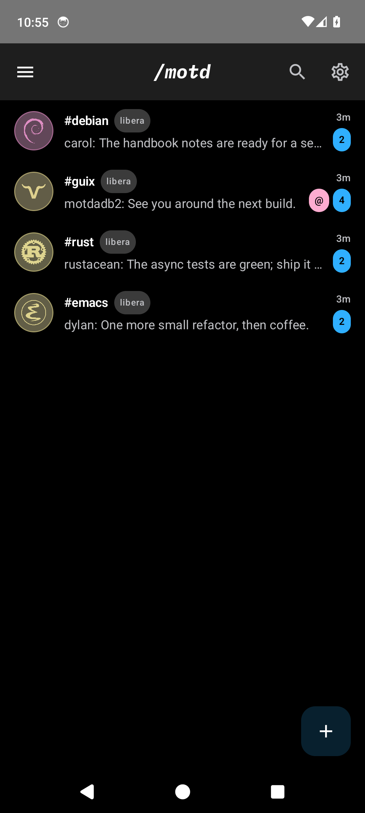
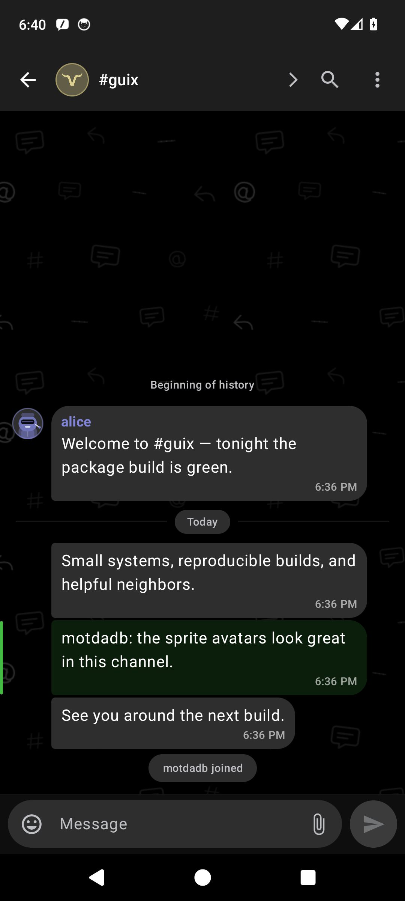
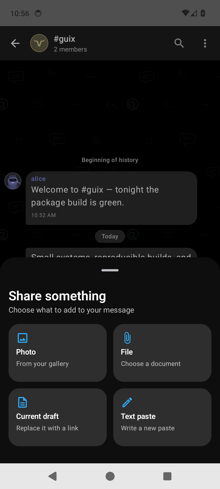
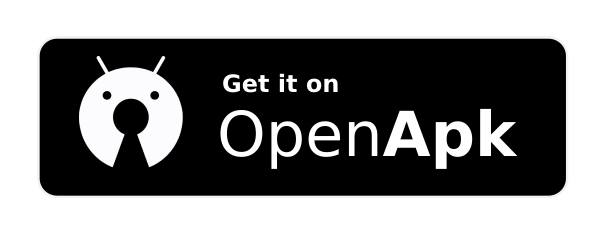

<p align="center">
  <picture>
    <source media="(prefers-color-scheme: dark)" srcset="docs/assets/brand/motd-lockup-dark.png">
    
  </picture>
</p>

<p align="center"><strong>A native Android IRC client with a Telegram-style chat UI.</strong></p>

<p align="center">
  <a href="https://github.com/trevarj/motd/releases/latest"></a>
  <a href="https://f-droid.org/packages/io.github.trevarj.motd"></a>
  <a href="https://github.com/trevarj/motd/releases"></a>
  <a href="https://github.com/trevarj/motd/actions/workflows/ci.yml"></a>
  <a href="LICENSE"></a>
  <a href="https://web.libera.chat/#motd"></a>
</p>

motd is built in Kotlin with Jetpack Compose and Material 3. It speaks IRCv3
and works best paired with a [soju](https://soju.im) bouncer — capabilities are
detected over CAP and enabled automatically — but it connects fine to plain
networks too, falling back to local-only history and a persistent socket.

- [Screenshots](#screenshots)
- [Features](#features)
- [Install](#install)
- [Connecting](#connecting)
- [Development](#development)
- [Community](#community)
- [License](#license)
- [Donations](#donations)

## Screenshots

Each frame is split diagonally between the Ayu Light and Ayu Dark themes. See
them in motion on the [landing page](https://trevs.site/motd/).

<table>
  <tr>
    <td align="center"><strong>Chat list</strong></td>
    <td align="center"><strong>Conversation</strong></td>
    <td align="center"><strong>File uploader</strong></td>
  </tr>
  <tr>
    <td><a href="screenshots/chat-list.png"></a></td>
    <td><a href="screenshots/chat.png"></a></td>
    <td><a href="screenshots/file-uploader.png"></a></td>
  </tr>
</table>

## Features

- **Telegram-style chat** — unified chat list, grouped bubbles, day separators, event pills, inline images, and link previews. **Show unread chats** temporarily filters the current network or folder to chats with local unread messages.
- **Infinite scrollback** — `draft/chathistory` paging through a bouncer, local-only history on plain networks. A floating date shows the day at the top of the timeline while you scroll. Sending a message while reading older history keeps your place. The timeline jump button names its destination and offers a separate accessible jump to newest when an unread mention is pending.
- **Cross-device read state** — `draft/read-marker` sync
- **Multi-network** — several networks over one bouncer connection (`soju.im/bouncer-networks`)
- **Preferred nickname reclaim**: opt in per direct network to switch back when IRC MONITOR reports your preferred nickname is free after a fallback sign-in. Manual nickname changes take precedence.
- **Private IRC notices**: enable **Show private notices in Server messages** per network to keep notices from new senders out of the chat list. Existing DMs and channel notices keep their usual destinations.
- **Push or persistent socket** — UnifiedPush + `soju.im/webpush` with on-device decryption, or a foreground service. Search Settings for **Test this alert** to post a local Android Messages or Mentions notification without testing IRC or push.
- **Quiet hours and away alerts** — in **Settings → Notifications**, mute message and mention alerts on a daily local schedule or while the IRC server confirms you are away. Both are opt-in; messages and unread counts still update.
- **Modern composer** — nick autocomplete, replies, typing indicators, and slash-command suggestions with inline remaining parameters (`<required>` and `[optional]`). In the default composer, tap `+` to attach a file while typing. In channels, `/op` asks ChanServ to grant you operator status if authorized; `/deop` removes it. Supply another nickname to change their status if the server permits it.
- **Hardware keyboard shortcuts** — use `Ctrl+F7` / `Ctrl+F8` to switch chats in the current list, or add `Shift` to skip to unread chats. In the composer, `Tab` / `Shift+Tab` cycle completion suggestions. The Chats and conversation menus list the shortcuts when a physical keyboard is connected.
- **Share multiple files** — share files from Android into one chat, review the upload destination, and retry failed files individually. **Add links** appends successful URLs to the draft in the original order without sending the message.
- **Upload library** — in the attachment chooser, find earlier uploads by filename or URL and reuse their links without reuploading. Star a link to keep it past the recent history limit. **Clear recents** removes only unstarred local records, not files on the hosting service.
- **Compress videos to fit** — when a video exceeds the selected upload limit, make a smaller MP4 on your device, review its exact size, and choose whether to upload it. The original is never replaced.
- **Scheduled messages** — hold Send in a channel or DM, or choose Schedule message from the conversation menu with an ordinary text draft, to send when connected or no earlier than a chosen date and time. Edit or cancel from Scheduled messages in the Chats menu, the conversation menu when there's no schedulable draft, or the scheduling sheet. Timed messages can try to reconnect in the background, but Android can delay the attempt. After 24 hours past the chosen time, they wait for your review instead of sending.
- **Message actions** — compact labeled icon grid, quick reactions, and a full Unicode emoji picker with touch scrolling, accessible categories, shared recents, and long-press variants, rendered with the selected emoji set. Messages show up to three reaction types inline; tap `+N` to see who reacted and add or remove any existing reaction the server allows. Share opens Android system sharing.
- **Saved messages** — save a channel or direct message from its action sheet, then open **Saved Messages** from Chats. Local copies survive history pruning; when motd receives a deletion for the original, it clears the saved text too.
- **Private nick notes** — write device-only notes from a nick's action sheet. A fresh WHOIS can identify the IRC account; otherwise the note is labelled **Nickname only**. Notes in those two scopes are never merged.
- **Activity** — browse IRC mentions, keyword matches, and new reactions to your messages together or filter by source. Tap a reaction to jump to the original message. Reactions do not trigger mention alerts. Add literal keywords in Chat settings and choose whether matches can trigger an alert.
- **Network-local ignore** — hide new messages from an exact nickname in its action sheet, or add a mask in **Network tools** that keeps messages visible and suppresses only the unread counts, highlights, or notifications you choose. A suppressed arrival doesn’t mark the chat read. Unignoring doesn’t restore dropped messages.
- **Bot identification** — [IRCv3 bot mode](https://ircv3.net/specs/extensions/bot-mode) adds a robot marker to known bots in chat, channel rosters, and nick details.
- **IRC profiles** — edit registered [IRCv3 metadata](https://ircv3.net/registry#user-metadata) in **User profile** for each network. Channel operators can publish a shared avatar and display name in **Channel info → Channel profile**. The server must support metadata and allow the change.
- **Channel directory** — open **Browse channels** to see results as the IRC server sends them, sort by name or population, and see when each section was last fetched.
- **Active channel bans** — Channel info → Ban list shows masks the IRC server returns, with setter and time when provided. Operators can confirm removal of an exact mask; the list refreshes from the server afterward.
- **Forward messages** — choose an existing chat on a Ready network and review the exact plain-text quotation before sending. “Include sender” is checked by default and optional; visible `> ` markers keep commands literal. Source and destination drafts stay untouched; saved-but-unsent messages are retried from destination history, not resent by the popup.
- **Read incoming chats aloud** — opt-in Android TTS with installed voice choices, speed, pitch, and message gap in Settings → Chat → Voice and audio → TTS Reader; previous, pause/resume, skip, latest, and stop controls; previews never enable chat reading
- **CTCP VERSION** — identifies motd and the running app version when a request reaches the client
- **Full-text search** — across local history or one buffer, with jump-to-message. Use `in:#channel`, `on:"Network name"`, and `from:alice from:bob` (either sender). Filters work with or without search words. Global search also previews five matching chat names; **See all matching chats** opens the rest.
- **Conversation links** — open **Links** in a channel or DM to browse link cards from messages saved on this device. Each card shows who posted it and when. Tap a card for link actions or its arrow to jump to the source. Existing previews can appear without fetching new previews or older history.
- **Theming** — Material You device colors, curated editor/terminal families (Ayu, Gruvbox, Catppuccin, Modus, and more), and editable, shareable local palettes with independent light and dark choices and System/Light/Dark mode; independent neutral/theme text and opt-in readability corrections; independent input, avatar, chat-card, and media shape presets with live previews; selectable Material (default) or Lucide interface icons
- **Readable menus and settings** — palette-accented headings, neutral value pills, distinct selected options, and contextual notes; adaptive labels show resolved values, including the device’s current time format. The chat overflow groups conversation actions, Read Aloud controls, and chat settings separately.
- **Hardened transport** — TLS with SASL PLAIN/EXTERNAL, client certificates, IRCv3 STS pinning, and optional SOCKS5/Tor/VLESS obfuscation
- **Recents privacy** — optionally hide chat previews in the Android 13+ task switcher under Settings → Security & privacy; normal screenshots still work

## Install

[](https://f-droid.org/packages/io.github.trevarj.motd)
[](https://trevs.site/motd/installation.html#obtainium)
[](https://www.openapk.net/motd/io.github.trevarj.motd/)

- **F-Droid**: [io.github.trevarj.motd](https://f-droid.org/packages/io.github.trevarj.motd)
- **GitHub**: APKs on the [releases page](https://github.com/trevarj/motd/releases/latest)
- **Obtainium**: [import the official GitHub release source](https://trevs.site/motd/installation.html#obtainium) for direct updates; no catalogue listing is required.
- **OpenAPK**: [existing third-party catalogue](https://www.openapk.net/motd/io.github.trevarj.motd/); its 0.20.3 download was verified against the original upstream APK on 2026-10-11.

F-Droid and GitHub share the same signing key, so either install updates from
the other. Obtainium downloads the original GitHub APK; the verified OpenAPK
download is byte-for-byte identical and preserves that update compatibility.
Requires Android 8.0+ on a 64-bit ARM device (the embedded obfuscation
transport is arm64-v8a-only). Push delivery is UnifiedPush — see the
[ntfy setup guide](docs/ntfy-push.md).
See the [Android distribution runbook](docs/android-distribution.md) for
channel provenance, publication status, and the maintainer checklist.

## Connecting

First run offers direct IRC or a soju/ZNC bouncer. Optional identity, sign-in
help, connection details, and history choices start collapsed; tap a heading
to expand them. Official account guides stay available without opening help.

**Direct**: add a network with host `irc.libera.chat`, port `6697`, TLS on,
and SASL PLAIN with your NickServ credentials (or SASL NONE).

**SASL EXTERNAL**: choose **Import certificate file** to open Android's file
picker and import a PKCS#12 (`.p12`/`.pfx`) containing your private key and
certificate, then authorize motd to use the installed identity. Selecting the
file grants access to that file; no storage permission prompt is needed.
**Use installed certificate** selects an identity already in Android KeyChain.
A certificate-only PEM file does not contain the private key required for EXTERNAL.

**Through a bouncer**: point the network at your soju bouncer and authenticate
with your bouncer account; motd negotiates capabilities and manages your
upstream networks from a single connection. For CLoak, follow the
[CLoak guide](docs/cloak.md).

For SOCKS5, Tor, or embedded VLESS (TCP + REALITY or WebSocket + TLS), see the
[obfuscation guide](docs/obfuscation.md).

## Development

The Nix flake pins the toolchain (JDK 21 + Android SDK); run everything under
`nix develop`. Quick start:

```sh
git submodule update --init --recursive
nix develop -c ./gradlew :app:assembleDebug
```

- [Architecture](ARCHITECTURE.md)
- [Building and testing](docs/human-developing.md)
- [All runbooks](docs/README.md) — releasing, F-Droid updates, backups
- [E2E harness](test/e2e/README.md) — screenshots regenerate with `nix develop -c ./test/e2e/headless.sh showcase`
- [F-Droid packaging](docs/fdroid.md)

## Community

Questions, bug reports, and feedback: join
[`#motd` on Libera.Chat](https://web.libera.chat/#motd), or open an
[issue](https://github.com/trevarj/motd/issues).

The app offers one dismissible chat-list invitation on new and existing
installations, excluding known channel members. **About → Project → MOTD community**
keeps the join/open action available afterward.

Joining requires your action; selecting the Libera preset no longer joins
automatically. The action reuses your Libera connection, including soju or ZNC,
and opens the channel if already joined. Ambiguous connections require a choice;
offline or missing connections lead to explicit connection/setup options rather
than silently creating a direct connection.

### Palette contributions

Create a palette in **Appearance → Palette**, then export its file from **Yours**.
Local palettes can have one mode; community submissions require complete light
and dark modes. Community refresh uses direct device HTTPS; installed copies work
offline.

Add `palettes/<id>/<revision>.motd-palette.json`, with matching ID and revision.
Never alter or remove published revisions; new revisions must exceed the previous
maximum for that ID. Regenerate and check the index:

```sh
nix develop -c python3 tools/palette-catalog.py --write
nix develop -c python3 tools/palette-catalog.py --check --base origin/main
nix develop -c python3 -m unittest discover -s tools -p test_palette_catalog.py
```

Submit the palette and generated index for review under the repository's existing
license terms, preserving supplied license and notice data. **Contribute** opens
the repository and offers file export; nothing is uploaded automatically.

## License

Copyright 2026 Trevor Arjeski. Licensed under the
[GNU GPL v3.0 or later](LICENSE). Third-party licensing is recorded in
[THIRD_PARTY_NOTICES.md](THIRD_PARTY_NOTICES.md).

This project has been developed with assistance from large language models;
contributions are reviewed, tested, and maintained by the project maintainer,
who remains responsible for the published code and releases.

## Donations

Donations are optional. To support development, use any of these destinations:

-  `bc1quyz4krs97k5d408kupukdu72pnghaahsuattfz`
-  `0xBD82C33D5812fb0F712f342f0B2b1394988541BD`
-  `8462JtvFaUqGEGpsZbToiv22FjSXN3wWrdXU4NPB898aG6zeyxD1xwC8hkVErGHHXnW2XYvmdhd75K3MRdeVizDU1BAENGq`
- [](https://www.paypal.com/donate/?business=tmarjeski%40gmail.com)
